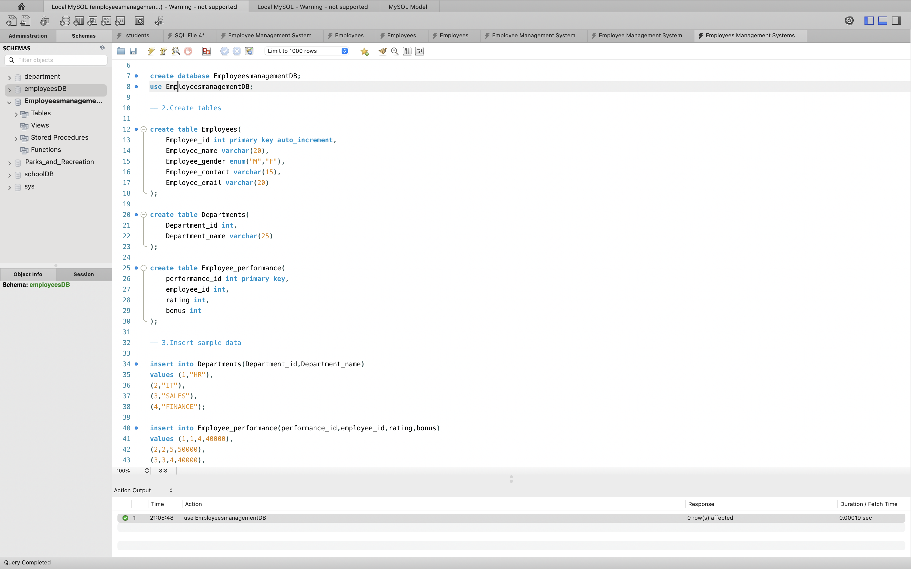
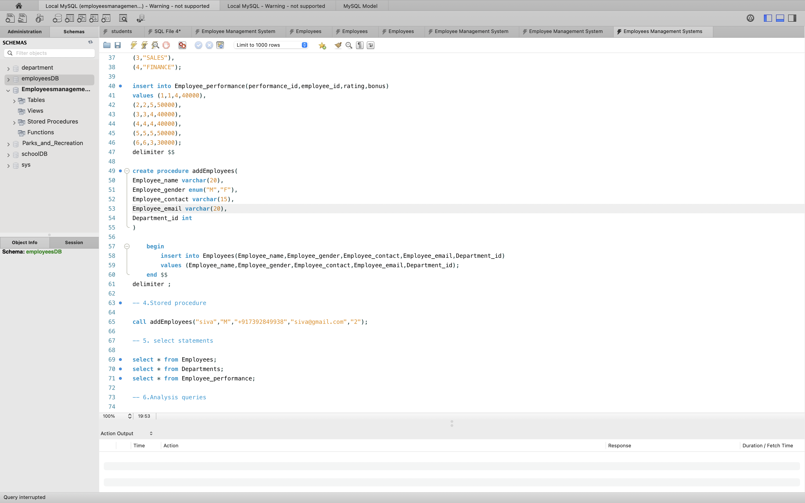

Employee Management System using MySQL

📌 Project Overview

The Employee Management System is a database project developed using MySQL to store, organize, and manage employee and department information efficiently. This project demonstrates the use of SQL queries and relational database concepts.

🎯 Project Objectives

* Create and manage employee records.
* Store and maintain department details.
* Establish relationships between tables using primary keys and foreign keys.
* Perform data insertion, modification, deletion, and retrieval.
* Practice SQL queries for database management.

🛠️ Technologies Used

* MySQL
* MySQL Workbench
* Structured Query Language (SQL)

🗂️ Database Structure

1. Employees Table

Stores employee-related information.

Columns:

* Employee_id – Unique employee identifier
* Employee_name – Employee name
* Employee_gender – Employee gender
* Employee_contact – Employee contact number
* Employee_email – Employee email address

2. Departments Table

Stores department-related information.

Columns:

* Dept_id – Department identifier
* Dept_name – Department name
* Budget – Department budget
* Emp_id – Employee reference, if configured in the database

Note: Update the column names above if your actual SQL table uses different names.

💡 SQL Concepts Covered

* CREATE DATABASE
* CREATE TABLE
* INSERT INTO
* SELECT
* WHERE
* UPDATE
* DELETE
* ALTER TABLE
* DROP TABLE
* PRIMARY KEY
* FOREIGN KEY
* Aggregate Functions
* Data Filtering and Retrieval

⚙️ Project Features

* Employee data storage and management
* Department information management
* Relational database design
* Data retrieval using SQL queries
* Database structure modification

🚀 How to Run the Project

1. Install MySQL Server and MySQL Workbench.
2. Download or clone this repository.
3. Open the .sql file in MySQL Workbench.
4. Execute the SQL statements to create the database and tables.
5. Insert sample records into the tables.
6. Run SELECT queries to view and verify the data.

📸 Project Screenshots
## 📸 Project Screenshots

### 1. Database Creation

### 2. Employees Table Output

### 3. Departments Table Output

📚 Learning Outcomes

* Understanding relational database concepts.
* Creating and managing tables using SQL.
* Working with primary keys and foreign keys.
* Writing SQL queries to manage and retrieve data.
* Practicing database operations using MySQL Workbench.

👨‍💻 Author

Shamsuthin M

📄 License

This project is created for learning and educational purposes.
